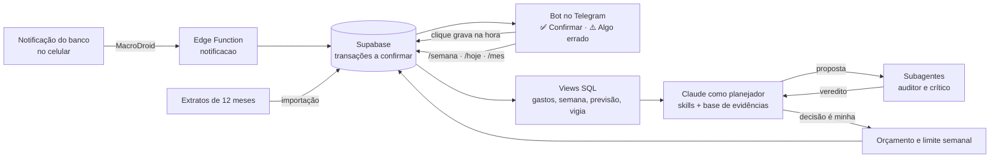

# Finanças Pessoais com Claude

Meu "departamento financeiro" pessoal: o **Claude age como planejador financeiro**, com regras escritas, base de evidências e revisores independentes, em cima de um banco de dados que se alimenta sozinho com as **notificações dos bancos no meu celular** e conversa comigo pelo **Telegram**.

Comecei com um site de controle financeiro e percebi que o problema não era a tela: era registrar tudo, saber para onde o dinheiro vai e decidir com dado em vez de impressão. Este repositório é a versão que eu uso todo dia.

> **Versão pública.** O sistema real roda num repositório privado. Aqui ficaram o código, o esquema do banco, as skills e os agentes, sem nenhum dado pessoal: perfil, orçamento, extratos e revisões viraram modelos em branco (ver [O que ficou de fora](#o-que-ficou-de-fora)).

## Como funciona



### 1. Registro automático (sem digitar nada)
- O **MacroDroid** no celular encaminha cada notificação dos apps de banco para uma **Edge Function** no Supabase.
- A função lê valor, lugar, conta e direção, chuta a categoria e grava como **"a confirmar"**. Ignora propaganda, compra negada e notificações repetidas.
- Na hora, chega uma mensagem no **bot do Telegram** com dois botões. Um clique confirma; "Algo errado" troca a categoria, descarta ou marca para revisão, sempre com **desfazer**.
- `/semana` mostra quanto gastei do limite semanal, lido do banco na hora.

### 2. O Claude como planejador
O `CLAUDE.md` e quatro **skills** transformam o Claude num planejador com rotina e regras:
- **`planejador`**: entrevista inicial, rituais (dia do salário, fechamento de domingo, fim do mês), regras de decisão e o **raio-x** dos gastos.
- **`contas`**: lançamentos, faturas, conciliação com saldo real e importação de extratos.
- **`posso-comprar`**: antes de uma compra, mostra o impacto na semana, no mês e na próxima meta. Acima de um valor-limite, sugere esperar 48 h.
- **`investidor`**: política de investimentos por "dinheiro" (função, prazo, risco) e diário de decisões.

Regras que valem para todas: **contas saem do banco, nunca de cabeça**; todo conselho **cita a fonte** ou se declara julgamento prático; mudança grande é **proposta antes**, e a decisão é sempre minha.

### 3. Revisores independentes (subagentes)
Antes de uma proposta chegar a mim, ela passa por outra instância do Claude, com **contexto limpo** e **só leitura**:
- **`auditor`**: audita propostas de decisão (orçamento, política de investimentos, migrações no banco). Refaz as contas e devolve **aprovar / aprovar com ajustes / refazer**.
- **`critico`**: tenta **derrubar cada conclusão** do raio-x dos gastos, refazendo as consultas no banco: o número está certo? é padrão ou ruído? conta algo duas vezes?

É o mesmo princípio de uma revisão por pares: quem fez a análise não é quem aprova.

### 4. Base de evidências
A pasta [`kb/`](kb/INDEX.md) resume, com citação e página, o que a pesquisa diz sobre orçamento, previsão de gastos, comportamento, dívidas, investimentos e impostos (Banco Central, CVM, Thaler, Mullainathan & Shafir, Barber & Odean, entre outros). Cada fonte tem um **nível de verificação** (V1 texto completo lido, V2 só resumo, V3 divulgação), e o planejador diz o nível quando usa.

### 5. Análise de dados
As contas vivem em **views SQL** ([`supabase/`](supabase/README.md)): gasto real pela data da compra (estornos descontados, parcelas no mês da fatura, transferências fora), semana × limite, previsão de 12 meses, patrimônio e um **vigia** de duplicados e gastos fora do padrão. O raio-x cruzou **12 meses de extratos de vários bancos** para responder de onde o dinheiro vem, para onde vai, quais são os maiores vazamentos em R$ e quando o saldo acaba no mês.

## Decisões que valem destacar
- **Segurança desde o início:** RLS ligado em todas as tabelas, a chave pública só alcança uma função de ping, segredos só no painel do Supabase e nomes pessoais em variáveis de ambiente, nunca no código.
- **Proposta → auditoria → aprovação → migração.** Exemplo real: [`supabase/proposta-telegram.md`](supabase/proposta-telegram.md) foi escrita, auditada e aprovada antes de qualquer linha de código.
- **Uma casa para cada fato.** Regras no `CLAUDE.md`, rituais na skill, números no banco. O Claude não tem memória entre sessões, então o estado precisa estar nos arquivos.

## Stack
Claude Code (skills, subagentes, hooks) · Supabase (Postgres, views, Edge Functions em Deno/TypeScript, RLS) · Bot API do Telegram · MacroDroid (Android) · GitHub Actions · Python

## Estrutura
```
CLAUDE.md                 regras fixas e mapa do repositório
.claude/skills/           planejador, contas, posso-comprar, investidor
.claude/agents/           auditor e critico (revisores independentes)
supabase/functions/       notificacao (celular → banco) e telegram (bot)
supabase/migrations/      esquema, views e segurança
kb/                       base de evidências com citações
scripts/                  briefing da sessão e busca nas fontes
profile.md, orcamento.md… modelos em branco (o real é privado)
```

## O que ficou de fora
Por privacidade e direito autoral, não estão aqui: meus dados (perfil, contas, orçamento, revisões, investimentos), os scripts de importação e classificação de extratos e de raio-x (cheios de nomes e regras pessoais) e o texto integral das fontes (só a lista e os resumos). Algumas referências nos arquivos apontam para essas partes.

---

Feito por **Fernando Pech** · [LinkedIn](https://linkedin.com/in/fernandonunespech)
